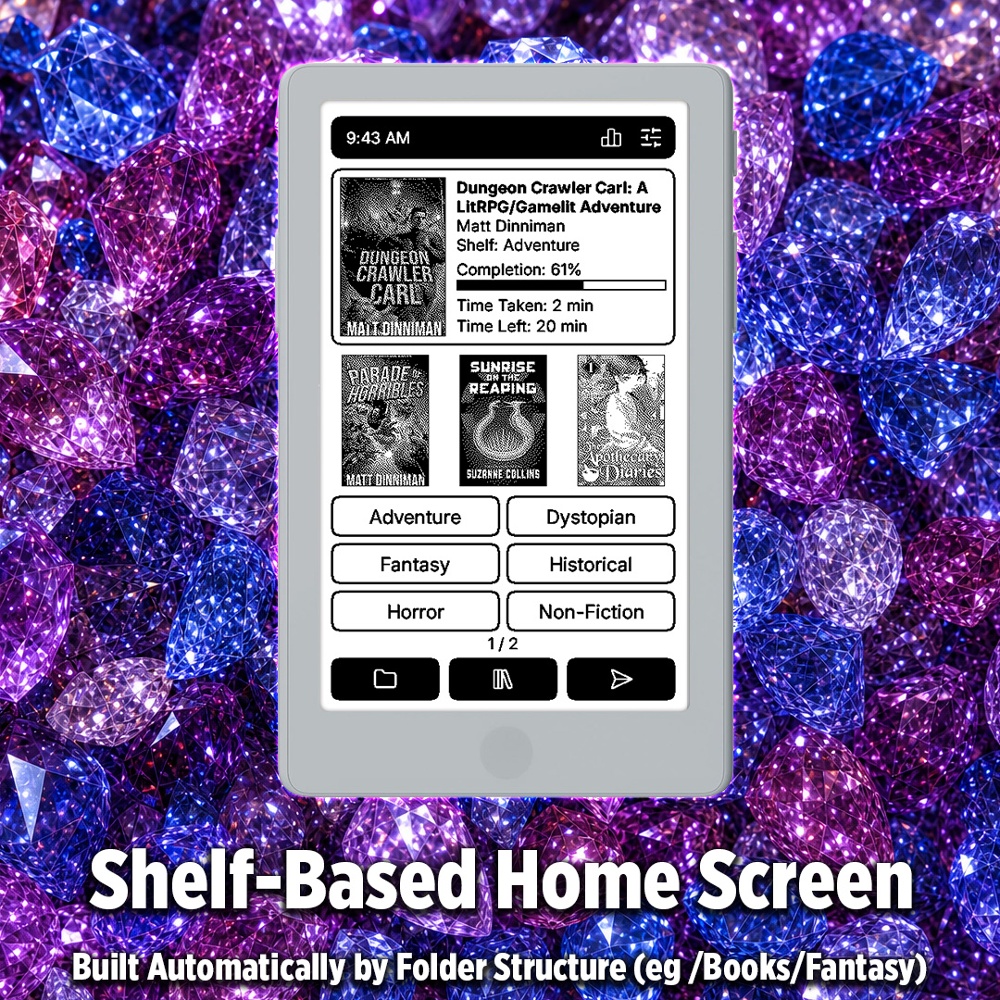
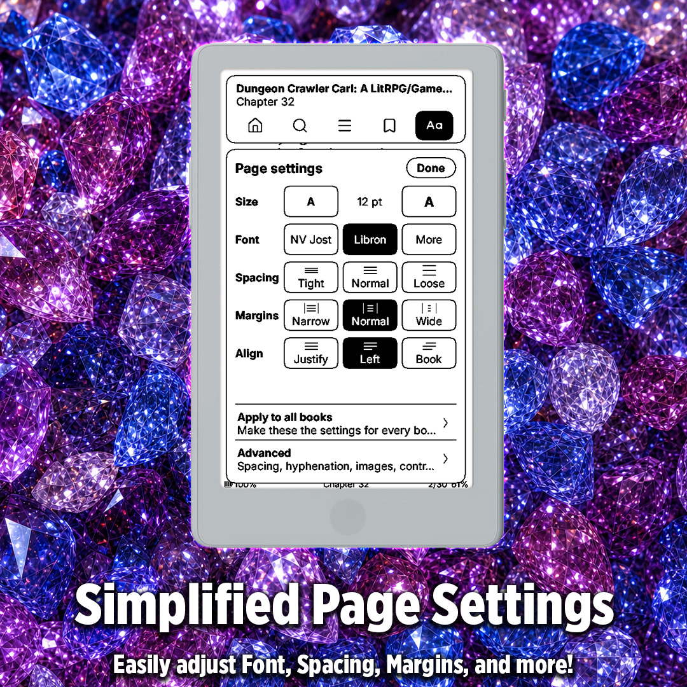
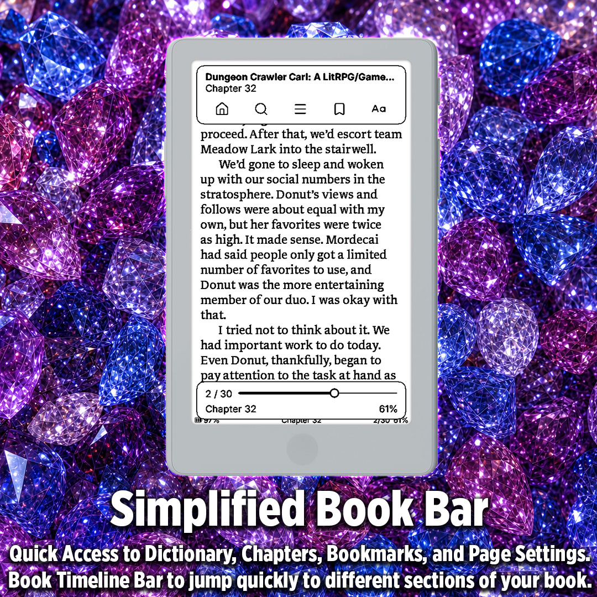
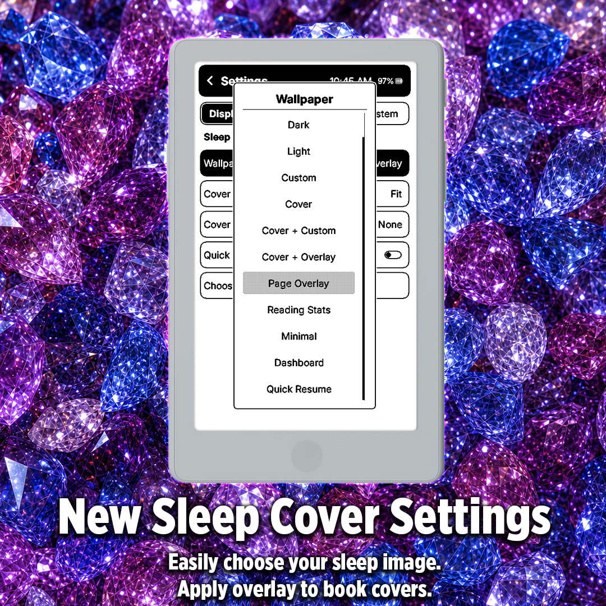

# QuartzInk

**QuartzInk** is a personal build of [CrossPoint Reader](https://github.com/crosspoint-reader/crosspoint-reader),
the open-source e-reader firmware. It keeps CrossPoint's reader underneath and gives it the look and habits of the
Quartz apps (Quartz Reader, Quartz Notes and friends): a Quartz Home screen with shelves, Quartz-style page
settings, reading stats that can leave the device, and a Quartz web dashboard.

<table>
  <tr>
    <td align="center" width="50%">
      
    </td>
    <td align="center" width="50%">
      
    </td>
  </tr>
  <tr>
    <td align="center" width="50%">
      
    </td>
    <td align="center" width="50%">
      
    </td>
  </tr>
</table>

### Supported devices

QuartzInk is built and tested on:

- **Xteink X4 Pro** (ESP32-S3, touch)
- **Xteink X3** (ESP32-C3, buttons)
- **Boox Picco** (ESP32-S3, touch)

CrossPoint's other targets still build from the same code, but are not tested here.

---

## What QuartzInk adds

### Quartz Home and shelves

Choose **Quartz** in Display → UI Theme (it's the default). Home shows:

- the current book with its cover, shelf, completion, time taken and time left;
- the next recent books;
- **shelves**: every folder inside `/Books` on the SD card becomes a shelf button that opens it, six to a page, so a
  card laid out as `/Books/Fantasy/…`, `/Books/Horror/…` gets a Fantasy and a Horror shelf. Swipe, or press
  Left/Right at the end of a row, for the next page;
- Library, File Transfer, Reading Stats and Settings.

Other themes keep their own Home screens.

### Quartz look everywhere

With the Quartz theme, every screen uses the same look: a black rounded title bar with the clock and battery, one
outlined segment control for tabs, and outlined rounded rows that fill black when selected.

### Page settings while reading

Tap the middle of the page (or press Confirm) for the Quartz page settings:

- **Toolbar:** Home, Look up, Contents, Bookmark (hold for the bookmark list) and Page settings.
- **Size, Font, Spacing, Margins and Alignment** as simple rows, with **Advanced** for everything else in
  CrossPoint's reader settings.
- A **timeline** at the bottom to scrub through the book.

### Fonts

- Built-in reading fonts: **NV Jost** (sans, default) and **Libron** (serif), from Nico Verbruggen's
  [e-reader fonts](https://github.com/nicoverbruggen/ebook-fonts), at 12, 14, 16 and 18 pt.
- More fonts install from the SD card; see [Custom SD-card fonts](#custom-sd-card-fonts) below. File Transfer's
  **Fonts** page installs a whole folder of font families at once.

### Reading stats

- **Reading Stats** on the device: reading time, streaks, a Reading Days calendar, when you read, and the books
  you've finished.
- File Transfer's **Stats** page shows the same, and `GET /api/stats` returns it as JSON
  ([format](./docs/stats-export.md)).
- [Quartz Reader](https://github.com/riseordie-85/QuartzReader) can import it straight from the reader
  (address `http://quartzink.local/`).

### Sleep and boot screens

- The QuartzInk boot screen, and the gem logo on the Dark and Light sleep screens.
- **Settings → Wallpapers** lists your sleep images in two tabs: **Wallpapers** (`/.sleep`, used by Custom and
  Cover + Custom) and **Overlays** (`/.sleep-overlay`, transparent PNGs drawn over the page or cover by Page
  Overlay and Cover + Overlay). Pin one image, or Shuffle for a random one each time.
- Overlays made for one screen size stretch to fill another device.

### File Transfer

- The web pages have the Quartz look, at `http://quartzink.local/`, with a tile home page.
- **Wallpapers** uploads photos as grayscale wallpapers sized for the device and PNGs as overlays, and pins or
  deletes them.
- **Extras** installs wallpapers, overlays and fonts from the [Quartz gallery](https://quartz.timcordova.com/extras/)
  with one tap each, sized for the reader's screen. Your phone or computer does the downloading, so the reader
  needs to be on your home Wi-Fi rather than its own hotspot.
- **Files** uploads whole folders with their subfolders.
- Moving or renaming a book keeps its reading progress, stats, bookmarks and clippings.

Everything else CrossPoint does (EPUB rendering, bookmarks, clippings, dictionaries, Focus Reading, KOReader progress
sync and more) is still here; see the [User Guide](./USER_GUIDE.md) and the [docs](./docs).

---

## Install

The easiest way is https://quartz.timcordova.com/flash/ in Chrome or Edge: pick your reader, plug it in over
USB-C and press **Install**. It installs the newest build of `main`.

- **Releases:** numbered versions are on the repo's **Releases** page as `quartzink-<version>-<device>.bin`
  (`x3-x4`, `x4pro` or `picco`). Install one from the install page under "Install a .bin file of your own".
- **Updates:** once a reader runs a build from version 1.0.0 on, the X3/X4 and X4 Pro can update themselves from
  **Settings → System → Check for updates**, which uses QuartzInk's releases. The Boox Picco updates over USB.
  Builds made before the 1.0.0 release (they show version 2.0.0) check upstream CrossPoint instead, so install
  a newer build over USB once.
- **Every push:** each run of **QuartzInk firmware** on the **Actions** tab has the builds as artifacts
  (`quartzink-x3-x4-<commit>`, `quartzink-x4-pro-<commit>`, `quartzink-picco-<commit>`), and pushes to `main`
  replace the `latest-build` pre-release that the install page uses. These use `x4-pro` in the name; releases
  use `x4pro`.

To go back to CrossPoint, flash an official CrossPoint release.

### Publishing a release

1. Set `version` in `platformio.ini` (under `[crosspoint]`) to the new version and push it.
2. On GitHub, open **Releases → Draft a new release**, create the tag `v<version>` (for example `v1.0.0`)
   on `main`, write the notes and press **Publish release**.
3. **QuartzInk release** builds the three readers' firmware and attaches it to the release a few minutes later.
   It stops with an error if the tag and `version` don't match. Then fix the version, delete the release **and its
   tag** (Releases → Tags), and publish again.

Pre-releases are not built. To test-build the release firmware without publishing, run **QuartzInk release**
from the **Actions** tab.

### USB-locked devices

Some Xteink units bought from third-party stores ship with USB flashing locked. CrossPoint's
[Xteink Unlocker](https://crosspointreader.com/#unlock-tool) is only meant for official CrossPoint firmware;
flashing other firmware on a locked device can leave it stuck with no way back. Unlock and install CrossPoint first,
then flash QuartzInk.

---

## Custom SD-card fonts

On devices with external RAM (the X4 Pro and Picco), copy `.ttf`, `.otf`, or `.ttc` files to the SD card and select
them as reader fonts. Put one file in `/fonts/` or `/.fonts/`, or put one family's files in a subfolder. See the
[SD card font guide](./docs/sd-card-fonts.md) for the folder layout and styles.

On other devices (the X3), convert the font to `.cpfont` first with the "SD-card font builder" at
https://crosspointreader.com/fonts, then copy the files to `/fonts/YourFont/`. `.cpfont` files also work on devices
with external RAM and are faster.

---

## Tips for the best reading experience

These devices have far less memory than a phone, so very large folders or complex EPUBs can be slower.

- Keep folders under about 200 files; 50-100 per folder browses best. Split large libraries into shelves under
  `/Books` by author, series or genre rather than putting every book in the card's root.
- Text-first EPUBs are the best fit. Large image-heavy EPUBs, scanned books and comics may load slowly or fail under
  memory pressure; EPUBs under 20 MB work best.
- If an EPUB is unusually slow, try File Transfer's **Optimize EPUB** option when uploading it.
- Use a reliable SD card and leave some free space for settings, progress, stats and book caches.

---

## Development quick start

QuartzInk uses PlatformIO. Initialize the submodules (including `freeink-sdk`) before the first build:

```sh
git submodule update --init --recursive
```

Then build or flash the environment for the device:

```sh
pio run -e default --target upload   # X3 / X4 (ESP32-C3)
pio run -e x4pro --target upload     # X4 Pro
pio run -e picco --target upload     # Boox Picco
```

See [Contributing docs](./docs/contributing/README.md) for prerequisites, tests and debugging, and
[Web server endpoints](./docs/webserver-endpoints.md) for the File Transfer API.

---

## Credits

QuartzInk is a CrossPoint project: it would not exist without
[CrossPoint Reader](https://github.com/crosspoint-reader/crosspoint-reader) and its contributors. If you like this
firmware, please consider [supporting them](https://app.royalty.dev/crosspoint-reader/crosspoint-reader). NV Jost,
Libron and the other NV fonts are by
[Nico Verbruggen](https://github.com/nicoverbruggen/ebook-fonts), under the SIL Open Font License.

QuartzInk is released under the same [MIT License](./LICENSE) as CrossPoint, and is **not affiliated with Xteink,
Boox or any device manufacturer**.
