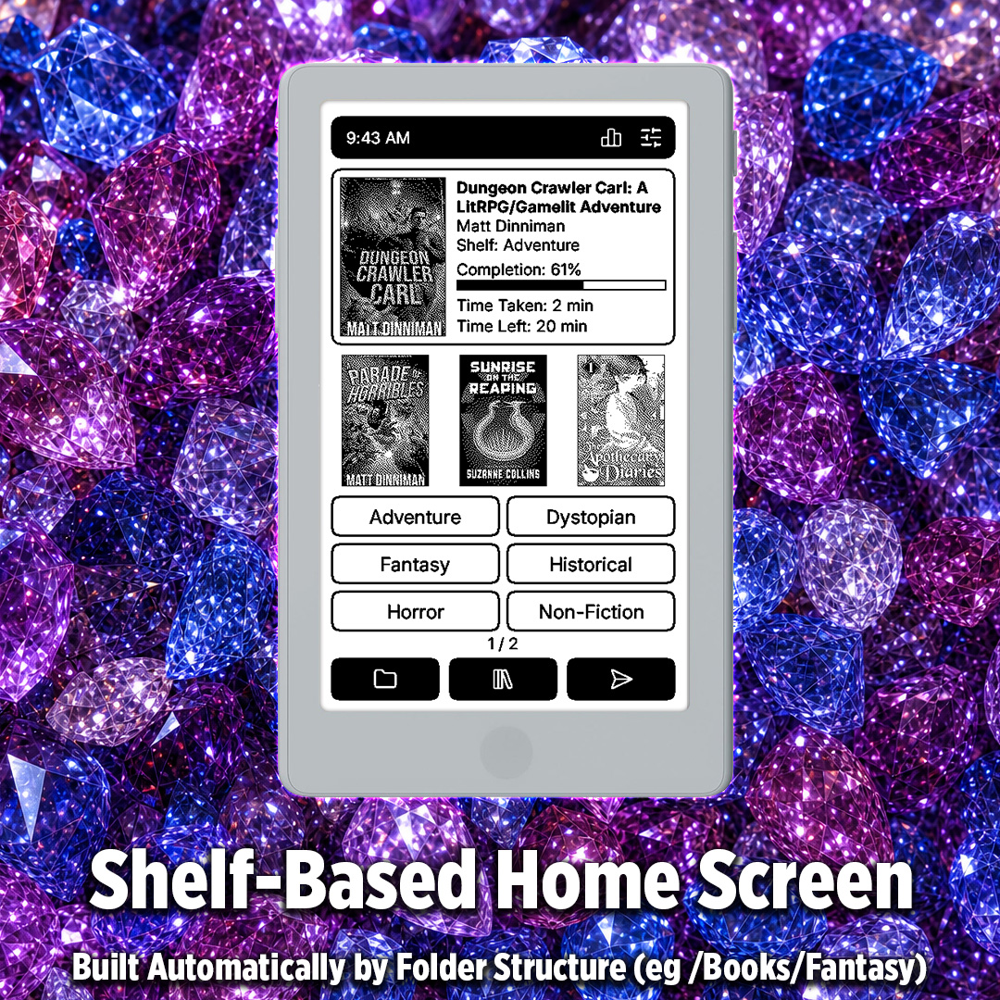
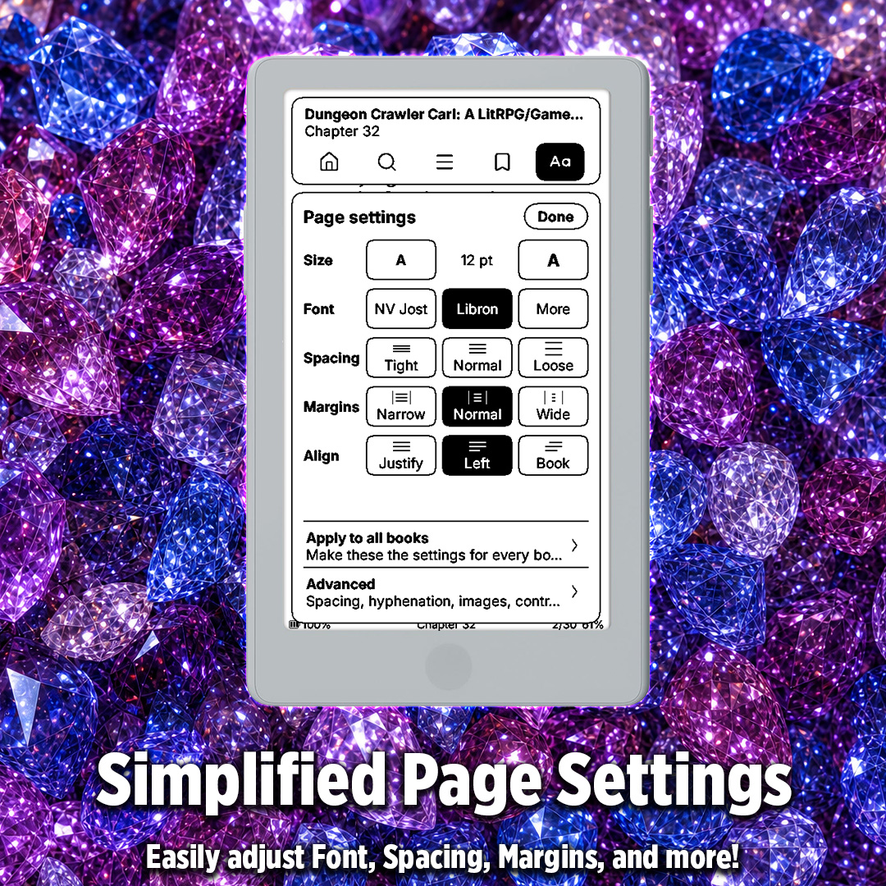
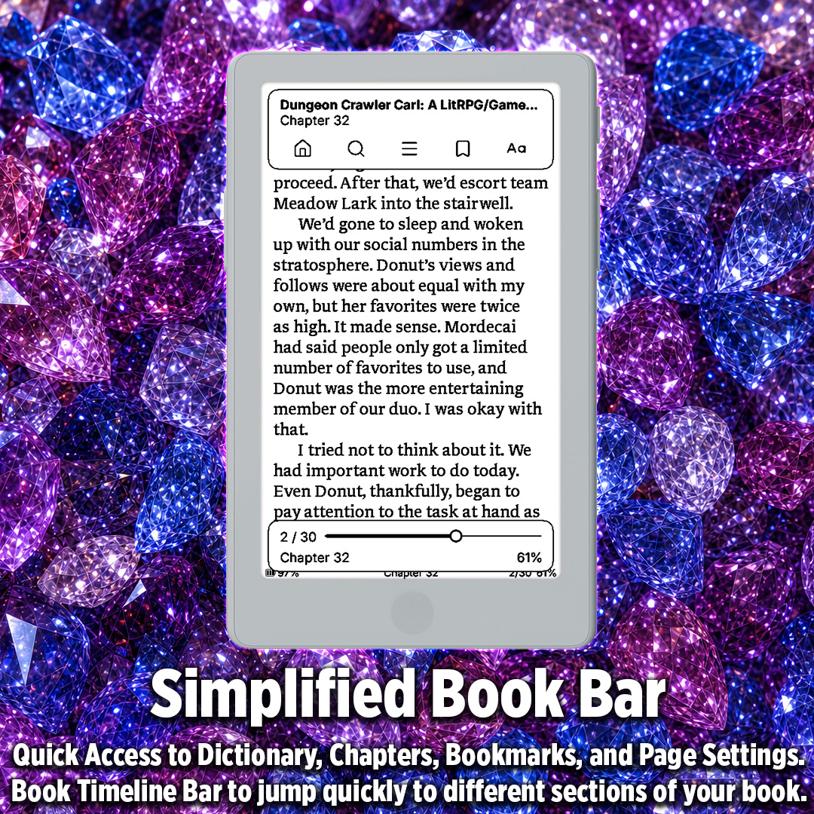
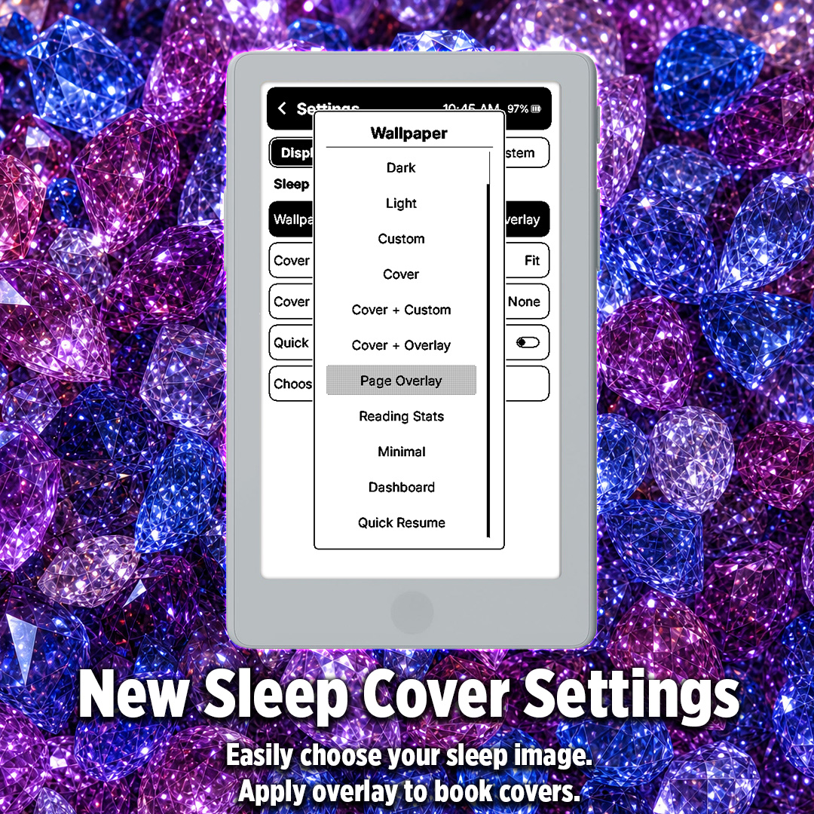

# QuartzInk

**QuartzInk** is a personal fork of [CrossInk](https://github.com/uxjulia/CrossInk), which is itself a fork of
[CrossPoint Reader](https://github.com/crosspoint-reader/crosspoint-reader). It keeps CrossInk's reader
underneath and gives it the look and habits of the Quartz apps (Quartz Reader, Quartz Notes and friends):
a Quartz Home screen with shelves, Quartz-style page settings, and reading stats that can leave the device.

<table>
  <tr>
    <td align="center" width="50%">
      
    </td>
    <td align="center" width="50%">
      
    </td>
  </tr>
  <tr>
    <td align="center" width="50%">
      
    </td>
    <td align="center" width="50%">
      
    </td>
  </tr>
</table>

### Supported devices

QuartzInk is built and tested on:

- **Xteink X4 Pro** (ESP32-S3, touch)
- **Xteink X3** (ESP32-C3, buttons)

CrossInk's other targets (X4, X4 Classic, Seeed Studio Sticky) still build from the same code, but are not tested here.

---

## What QuartzInk adds

### Quartz Home and shelves

Choose **Quartz** in Display → UI Theme (it's the default). Home shows:

- a black top bar with the clock, battery, Reading Stats and Settings;
- the current book with its cover, shelf, completion, time taken and time left;
- the next three recent books;
- **shelves**: every folder inside `/Books` on the SD card becomes a shelf button that opens it (six per page, swipe
  for more), so a card laid out as `/Books/Fantasy/…`, `/Books/Horror/…` gets a Fantasy and a Horror shelf;
- Browse Files, Library and File Transfer along the bottom.

On the X3 the selected item turns black with white text. Other themes (Lyra, Cover Grid, Classic and the rest) keep
their own Home screens.

### Quartz look everywhere

With the Quartz theme, every screen uses the same look: a black rounded title bar with the clock and battery, one outlined
segment control for tabs, and outlined rounded rows that fill black when selected.

### Page settings while reading

Tap the middle of the page (or press Confirm) for the Quartz page settings:

- **Toolbar:** Home, Look up, Contents, Bookmark (hold for the bookmark list) and Page settings.
- **Size, Font, Spacing, Margins and Alignment** as simple rows, plus an **Advanced** page for line and word spacing,
  hyphenation, anti-aliasing, Focus Reading, Guide Dots, margins, indents, orientation, images and more.
- **Apply to all books** makes the current settings everyone's defaults.
- A **timeline** at the bottom to scrub through the book.

### Fonts

- Built-in reading fonts: **NV Jost** (sans, default) and **Libron** (serif), from Nico Verbruggen's
  [e-reader fonts](https://github.com/nicoverbruggen/ebook-fonts). On the X4 Pro they scale to any size.
- More fonts install from the SD card (`/fonts/<Family>/`): `.ttf` files on the X4 Pro, `.cpfont` packs on the X3.
  `lib/EpdFont/scripts/quartzink-fonts.yaml` builds the X3 packs for Readerly and the rest of the NV core set.

### Reading stats that leave the device

- File Transfer's home page has **Download reading stats**, and `GET /api/stats` returns the same JSON
  ([format](./docs/stats-export.md)).
- [Quartz Reader](https://github.com/riseordie-85/QuartzReader) can import it straight from the reader
  (Settings → Import from e-reader, address `http://quartzink.local/`).

### Sleep and boot screens

- QuartzInk boot logo, and the gem on the Dark and Light sleep screens.
- **Cover + Overlay**: the book's cover with a transparent PNG frame on top (Page Overlay's PNGs work here too).
  Overlays made for one screen size stretch to fill the other device.
- **Choose Sleep Image** in Display → Sleep Screen opens your sleep folder, even the hidden `/.sleep`.

### File Transfer

- The web pages are QuartzInk-branded, at `http://quartzink.local/`.
- **Files** uploads whole folders with their subfolders; **Fonts** installs a folder of font families at once.
- Moving a book keeps its reading progress, stats, bookmarks and clippings.

Everything CrossInk already did (reading stats, bookmarks, clippings, dictionaries, Focus Reading, Guide Dots,
button remapping, progress sync and more) is still here; see the [docs](./docs) and
[CHANGELOG.md](./CHANGELOG.md).

---

## Tips for the best reading experience

QuartzInk runs on an ESP32-C3 (X3) or ESP32-S3 (X4 Pro) with limited RAM, so very large folders or complex EPUBs can be slower than they would be on a phone, tablet, or desktop app.

- Keep folders under about 200 files. For the smoothest browsing, aim for 50-100 files per folder.
- Having 1000+ books on the SD card is fine if they are split into smaller folders, such as by author, series, genre, or read/unread status.
- Avoid putting every book in the SD card root. The file browser has to scan and sort the current folder before it can show it.
- Text-first EPUBs are the best fit. Large image-heavy EPUBs, scanned books, comics, and omnibus files with thousands of sections may load slowly or fail under memory pressure.
- As a rough target, EPUBs under 20 MB tend to work the best. Files over 50 MB may still work, but they are more likely to be slow or memory-sensitive, especially if they contain many large images.
- If an EPUB is unusually slow, try [optimizing](./docs/webserver.md#epub-optimization) it with the built-in web optimizer (via File Transfer) before copying it to the SD card: remove unused high-resolution images, split very large omnibus files, and avoid embedding multiple full font families when possible.
- Use a reliable SD card and leave some free space. QuartzInk stores settings, reading progress, cache files, stats, and generated book data on the card.

---

## Installation

GitHub Actions builds QuartzInk on every push to this repository:

1. Open the repo's **Actions** tab and pick the newest green **QuartzInk firmware** run.
2. Download the artifact for your device from **Artifacts**: `quartzink-x4-pro-<commit>` or
   `quartzink-x3-x4-<commit>`.
3. Unzip it and flash the `.bin` with [Inky's flash tools](https://inky.crossink.dev/#flash-tools) or PlatformIO.

See [Installation](./docs/installation.md) for step-by-step flashing and how to go back to stock firmware.

---

## Development quick start

QuartzInk uses PlatformIO for building and flashing firmware. See [Getting Started](./docs/development/getting-started.md) for prerequisites, clone setup, and validation commands.

### Nix/NixOS

Nix/NixOS users can enter the development shell with either `nix develop` (flakes) or `nix-shell`:

```bash
nix develop -f nix
# or
nix-shell nix
```

To flash a connected ESP32-C3 device, enable PlatformIO's udev rules in your NixOS configuration:

```nix
services.udev.packages = with pkgs; [ platformio-core.udev ];
```

After rebuilding the system configuration, reconnect the device or reload udev rules.

### Build / flash / monitor

Connect your device to your computer via a USB cable. Before the first build, initialize the repository's submodules (including `freeink-sdk`):

```sh
git submodule update --init --recursive
```

Then flash the firmware using the correct environment for the device. The `default` environment is for the X3/X4 devices. ESP32-S3 devices have their own named environments.

```sh
pio run -e default --target upload
```

If PlatformIO reports `PackageException: Can not create a symbolic link for freeink-sdk/libs/hardware/BatteryMonitor, not a directory`, the `freeink-sdk` submodule is not initialized. Run the submodule command above and retry.

See [Testing and Debugging](./docs/development/testing-debugging.md) for serial logging, simulator checks, static analysis, and bug-report guidance.

---

## Credits

QuartzInk would not exist without [CrossInk](https://github.com/uxjulia/CrossInk) by uxjulia and
[CrossPoint Reader](https://github.com/crosspoint-reader/crosspoint-reader) and its contributors. If you like this
firmware, please consider supporting them. NV Jost, Libron and the other NV fonts are by
[Nico Verbruggen](https://github.com/nicoverbruggen/ebook-fonts), under the SIL Open Font License.

QuartzInk is released under the same [MIT License](./LICENSE) as CrossPoint.
